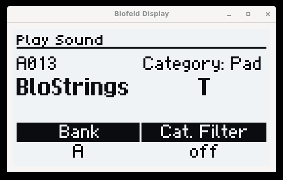

# blofeld-emu

blofeld-emu boots the original Waldorf Blofeld Desktop 1.25 firmware on Linux
x86-64 and macOS ARM64. The original MCU firmware starts the DSP, handles MIDI
and drives the LCD. The original DSP code generates the stereo audio.

Our CPU12 and DSP56300 cores compile the firmware and device bindings ahead of
time with LLVM 19, including the code variants selected by the original loader.
The two processors run on separate host threads and exchange timestamped events.
Live playback follows the audio device's clock. Offline MIDI-to-WAV rendering
runs the same instrument as fast as the host allows.

[Quickstart](doc/quickstart.md) · [Architecture](doc/architecture.md) ·
[Qualification](ACCEPTANCE.tsv) · [License](LICENSE) ·
[Dependency notices](THIRD_PARTY.txt)

